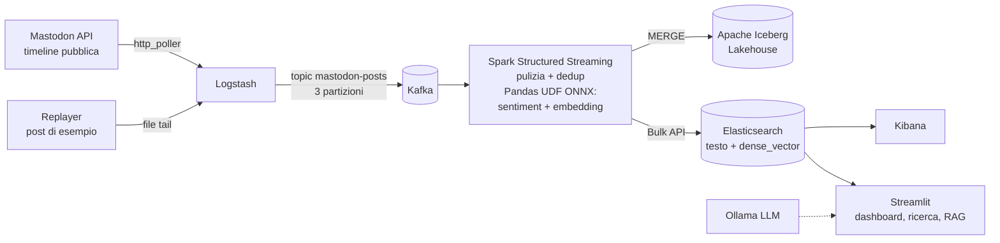

# TAP Sentiment Stream

Pipeline end-to-end per l'analisi del **sentiment in tempo reale** dei post pubblici di Mastodon,
con **ricerca semantica** e un piccolo sistema **RAG** per interrogare i dati in linguaggio naturale.

Progetto per l'esame di *Technologies for Advanced Programming* (A.A. 2026/2027, prof. Salvatore Nicotra).
Autore: Mario Gabriele.

Le versioni seguono quelle usate a lezione nei repository [tap2026](https://github.com/tapunict/tap2026) e [tap2027](https://github.com/tapunict/tap2027) (Spark 4.0.1, Logstash 9.5.5, Kafka in KRaft).



| Layer | Tecnologia | Ruolo |
|---|---|---|
| Ingestion | Logstash 9.5 | Polling dell'API Mastodon (o lettura del file di replay), filtro e normalizzazione |
| Streaming | Apache Kafka 4.1 (KRaft) | Backbone: disaccoppia produttori e consumatori, buffer persistente, replay |
| Processing | Spark 4.0 Structured Streaming | Parsing, pulizia, deduplica, micro-batch con checkpoint |
| AI Inference | ONNX Runtime (Pandas UDF) | DistilBERT SST-2 per il sentiment, MiniLM per gli embedding (384 dim.) |
| Storage | Apache Iceberg 1.10 | Storico analitico: ACID, time travel, schema evolution |
| Indexing / Search | Elasticsearch 9.5 | Full-text + ricerca vettoriale kNN |
| Consumption | Kibana, Streamlit, Ollama | Dashboard, ricerca semantica, RAG |
| Deploy | Docker Compose | Tutto in container, avvio con un comando |

## Requisiti

- Docker Desktop (o Docker Engine + Compose v2). Con le impostazioni di default il progetto gira su un portatile
  con **8 GB di RAM**: Kibana e Kafka UI sono opzionali (`--profile extra`), perche' insieme chiedono circa 2 GB in piu'
- Internet al primo build (immagini, connettori Maven, modelli Hugging Face) e per la modalita' live

## Avvio

```bash
cp .env.example .env          # opzionale: personalizza sorgente, soglie, modello LLM

make up                       # live da Mastodon   (= SOURCE=mastodon docker compose up -d --build)
make replay                   # offline, post di esempio (= SOURCE=replay docker compose --profile replay up -d --build)
make extra                    # opzionale: Kibana e Kafka UI (servono almeno 12-16 GB di RAM nel PC)
make llm                      # opzionale: avvia Ollama e scarica il modello per il RAG
```

Il primo build richiede qualche minuto. Poi:

| Servizio | URL |
|---|---|
| Streamlit (dashboard, ricerca, RAG) | http://localhost:8501 |
| Kibana (con `--profile extra`) | http://localhost:5601 |
| Kafka UI (con `--profile extra`) | http://localhost:8080 |
| Spark UI (micro-batch, tempi) | http://localhost:4040 |
| Elasticsearch | http://localhost:9200 |

Comandi utili:

```bash
make logs                     # log di Spark e Logstash (si vede ogni micro-batch con le sue metriche)
make demo                     # demo Iceberg: query SQL, snapshot, time travel
make evolve                   # come sopra + schema evolution (ALTER TABLE ADD COLUMN)
make down                     # ferma tutto (i dati restano nei volumi)
make clean                    # ferma tutto e cancella i dati
curl 'localhost:9200/mastodon-posts/_count'
```

> **All'esame:** se la rete dell'aula non e' affidabile usa `make replay`: la pipeline e' identica,
> cambia solo l'input di Logstash. Se un'istanza Mastodon non espone la timeline pubblica senza
> login, cambia `MASTODON_URL` nel file `.env` (es. `https://mastodon.social`). L'istanza di default, `mastodon.cloud`, e' quella usata negli esempi del corso.

### Dashboard Kibana

Con `--profile extra`, `kibana-init` crea in automatico le data view `mastodon-posts` e `pipeline-metrics`.
Per una dashboard in 3 minuti: *Analytics → Dashboards → Create → Create visualization* e aggiungi

1. **Bar vertical stacked**: asse X `created_at` (date histogram), breakdown `sentiment`;
2. **Donut**: slice by `sentiment`;
3. **Metric**: average di `sentiment_value`;
4. **Table**: top values di `hashtags` con average di `sentiment_value`;
5. sulla data view `pipeline-metrics`: **Line** di `avg_latency_s` e `rows_in` per `processed_at`.

### Windows (senza `make`)

In PowerShell, dalla cartella del progetto:

```powershell
$env:SOURCE="replay"
docker compose --profile replay up -d --build      # avvio offline
docker compose logs -f spark                        # log dei micro-batch (Ctrl+C per uscire)
docker compose exec spark /opt/spark/bin/spark-submit /opt/app/iceberg_demo.py --evolve
docker compose --profile replay down                # stop
```

Su un PC con 8 GB di RAM conviene limitare la memoria che WSL2 (e quindi Docker) puo' prendere,
altrimenti Windows resta senza memoria e si blocca. Crea `%USERPROFILE%\.wslconfig` con

```ini
[wsl2]
memory=4GB
processors=2
swap=4GB
```

poi chiudi Docker Desktop, esegui `wsl --shutdown` e riaprilo.

## Struttura

```
docker-compose.yml          tutti i servizi
logstash/pipelines/         input (mastodon | replay) + filtro e output comuni
setup/                      mapping Elasticsearch, init di Kibana, script del replayer
data/sample_posts.jsonl     40 post di esempio (scritti a mano, non reali) per la modalita' offline
common/onnx_models.py       wrapper ONNX Runtime per sentiment ed embedding (usato da Spark e Streamlit)
common/download_models.py   scarica i modelli ONNX da Hugging Face al build
spark/app/streaming_job.py  job Spark Structured Streaming
spark/app/iceberg_demo.py   demo Lakehouse (time travel, schema evolution)
streamlit/app.py            dashboard live, ricerca semantica, RAG
tests/                      test con modelli ONNX "giocattolo" e Iceberg reale
docs/RELAZIONE.md           relazione del progetto
```

## Test

```bash
pip install -r tests/requirements.txt
# serve Java 17 o 21 e il jar iceberg-spark-runtime-4.0_2.13-1.10.1 in tests/jars/
python -m pytest -q tests
```

## Note e limiti

- Il modello di sentiment e' addestrato su recensioni in inglese: Logstash tiene solo i post `language = en`.
  Per l'italiano basta sostituire il modello con uno multilingue (vedi relazione, sezione sviluppi futuri).
- Il modello SST-2 e' binario: la classe `neutral` e' ottenuta con una soglia sulla confidenza (`NEUTRAL_THRESHOLD`).
- Configurazione da sviluppo: un solo broker Kafka, un nodo Elasticsearch senza sicurezza, Spark in `local[*]`.
