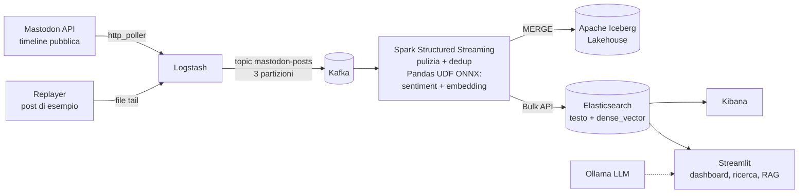

# TAP Sentiment Stream

Pipeline end-to-end per l'analisi del sentiment in tempo reale dei post pubblici di Mastodon,
con ricerca semantica e un piccolo sistema RAG per fare domande sui dati.

Progetto per l'esame di Technologies for Advanced Programming (A.A. 2026/2027, prof. Salvatore Nicotra).
Autore: Mario Gabriele Vittoria.



## Avvio

```bash
cp .env.example .env    # opzionale, per cambiare le impostazioni

make up       # dati live da Mastodon
make replay   # senza internet, con i post di esempio
make extra    # aggiunge Kibana e Kafka UI (serve piu' RAM)
make llm      # avvia Ollama per il RAG
```

Dopo l'avvio i servizi sono raggiungibili qui:

| Servizio | URL |
|---|---|
| Streamlit (dashboard, ricerca, RAG) | http://localhost:8501 |
| Kibana (con `--profile extra`) | http://localhost:5601 |
| Kafka UI (con `--profile extra`) | http://localhost:8080 |
| Spark UI | http://localhost:4040 |
| Elasticsearch | http://localhost:9200 |

In PowerShell, dalla cartella del progetto:

```powershell
$env:SOURCE="replay"
docker compose --profile replay up -d --build      # avvio offline
docker compose logs -f spark                        # log dei micro-batch
docker compose exec spark /opt/spark/bin/spark-submit /opt/app/iceberg_demo.py --evolve
docker compose --profile replay down                # stop
```

Su un PC con 8 GB di RAM conviene limitare la memoria di WSL2, altrimenti Windows si blocca.
Crea il file `%USERPROFILE%\.wslconfig` con:

```ini
[wsl2]
memory=4GB
processors=4
swap=4GB
```

dopo averlo salvato chiudi Docker Desktop, scrivi `wsl --shutdown` in PowerShell e riapri Docker

La relazione completa e' in [docs/RELAZIONE.md](docs/RELAZIONE.md).

## Test

```bash
pip install -r tests/requirements.txt
# serve Java 17 o 21; i 2 test su Iceberg partono solo con il jar in tests/jars/
python -m pytest -q tests
```
